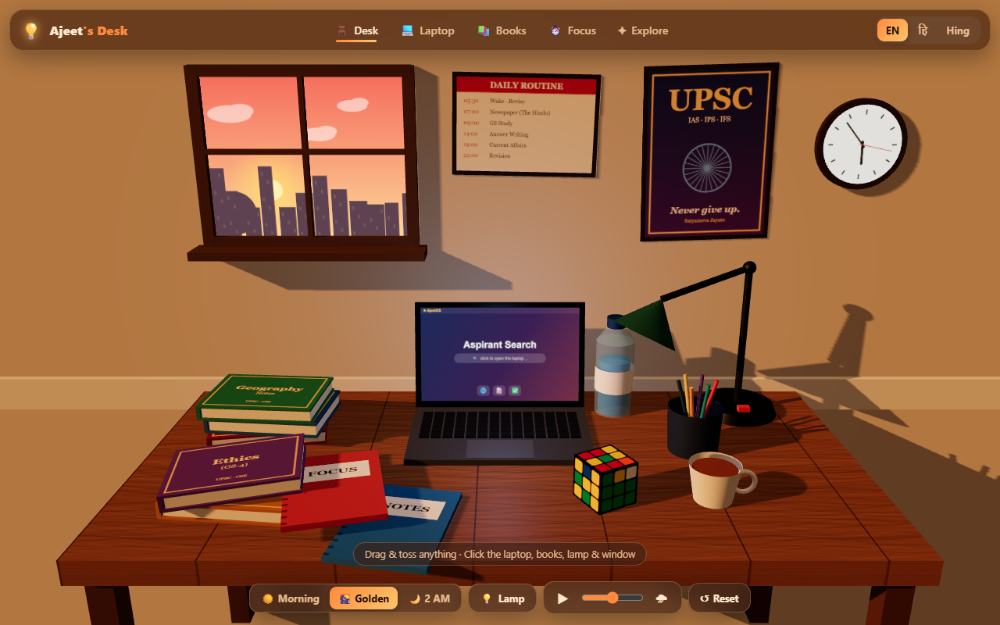
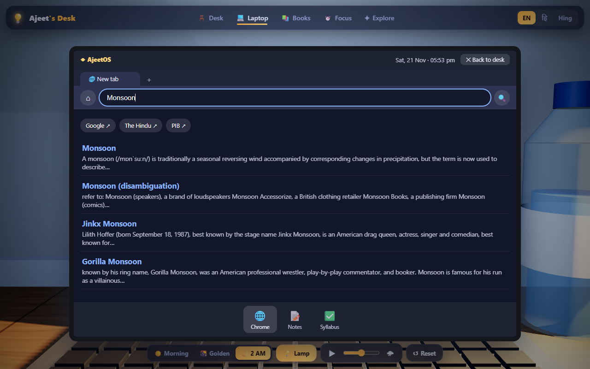
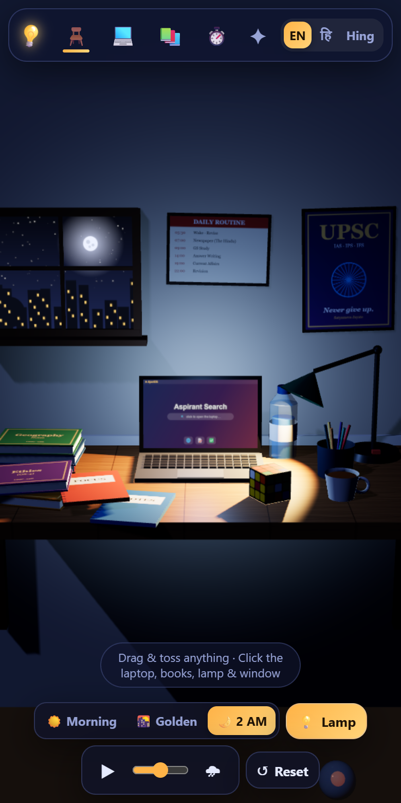

# 🪑 Ajeet's UPSC Desk — a 3D study room you can touch

> The landing page *is* a desk. Open books, run the laptop, flip the lamp, toss the water bottle — all in 3D, all in your browser.

**🔗 Live site:** https://ajeet-iitk.github.io/upsc-desk/



| ☀️ Morning | 🌙 2 AM revision mode |
|---|---|
|  |  |

| 💻 Laptop OS + Chrome search | 📚 Open any book |
|---|---|
|  |  |

<p align="center"></p>

## ✨ What you can do

- **Run the laptop** – click it and the camera zooms in to a tiny web OS: a working **Chrome-style search** (results from the Wikipedia API), **Notes** (auto-saved) and a **Syllabus tracker** (progress saved locally).
- **Day / golden hour / 2 AM** – the window sky, sun & moon, shadows, lighting and even the UI theme blend smoothly. At night the **desk lamp** glows and city windows light up.
- **Real physics** (Three.js + cannon-es) – grab, drag and toss the water bottle, pen stand, Rubik's cube, glass paperweight, chai cup, books and notebooks. Each material has its own sound (plastic thud, paper rustle, glass ting, cube clack).
- **Books** – five subject books (Polity, History, Geography, Economy, Ethics) with high-yield revision notes.
- **Revision timer** – click the red notebook for a Pomodoro (25 / 5 / 50).
- **Lo-fi music + rain** – generated live with WebAudio. No audio files, no copyright worries. Volume + rain controls included.
- **Languages** – English · हिंदी · Hinglish.
- **Explore panel** – a list of every interactive thing on the site.
- **Mobile friendly** – touch to drag, swipe the empty wall to pan.

## 🚀 Run locally

It is a static site (no build step). ES modules need a server:

```bash
npx serve .          # or: python -m http.server 8000
```

Open the printed URL. Three.js and cannon-es load from the jsDelivr CDN.

## 🧱 Tech

Three.js r160 · cannon-es 0.20 · WebAudio · vanilla JS modules · zero build tools.

```
index.html      page + UI markup
css/style.css   glass UI, day/night themes, responsive
js/main.js      3D scene, physics, lighting, camera, input
js/os.js        laptop OS (search, notes, syllabus)
js/audio.js     generated music, rain and sound effects
js/books.js     book notes
js/i18n.js      EN / HI / Hinglish strings
```

## 💡 Ideas for later

Answer-writing coach (timer + word counter), current-affairs "newspaper" you can unfold, mock-test mode on the laptop, a wall calendar counting down to Prelims, a tea-making mini game, a shareable "my desk" snapshot, streaks for daily study hours.

---
Made with ☕ and too many tabs open.
