# 🪑 Ajeet's UPSC Desk: a 3D study room you can touch

> The landing page *is* a desk. Open books, run the laptop, check the phone, slide the curtains, open the window for birdsong, flip the lamp, toss the water bottle. All in 3D, all in your browser.

**🔗 Live site:** https://ajeet-iitk.github.io/upsc-desk/
**💻 Offline:** just double-click `index.html`. It works from a plain file, no server needed.


| ☀️ Morning, window open | 🌙 2 AM revision mode |
|---|---|
| 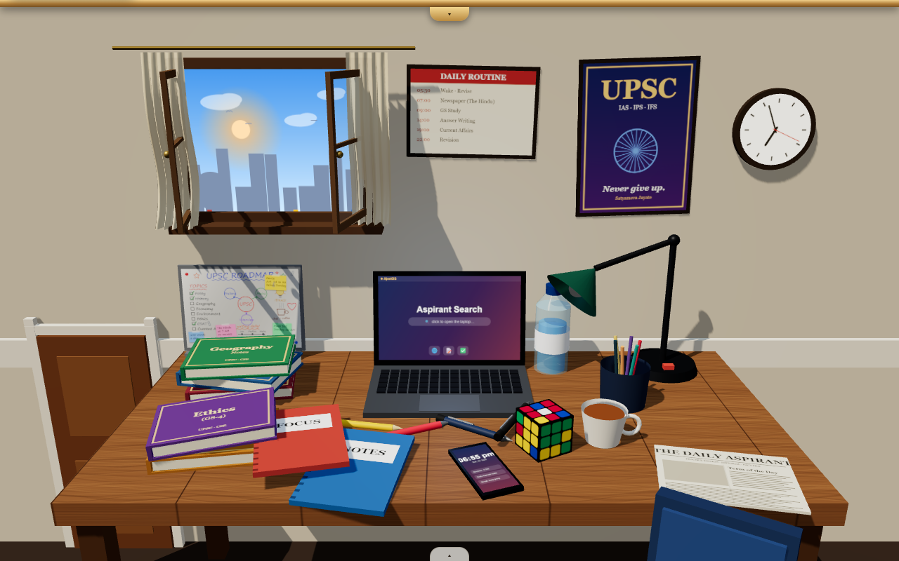 | 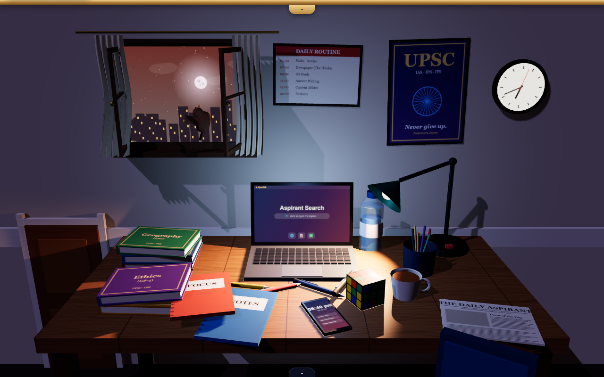 |

| 💻 Laptop OS + search | 📚 Books | 📱 Phone | 📰 Newspaper |
|---|---|---|---|
|  | 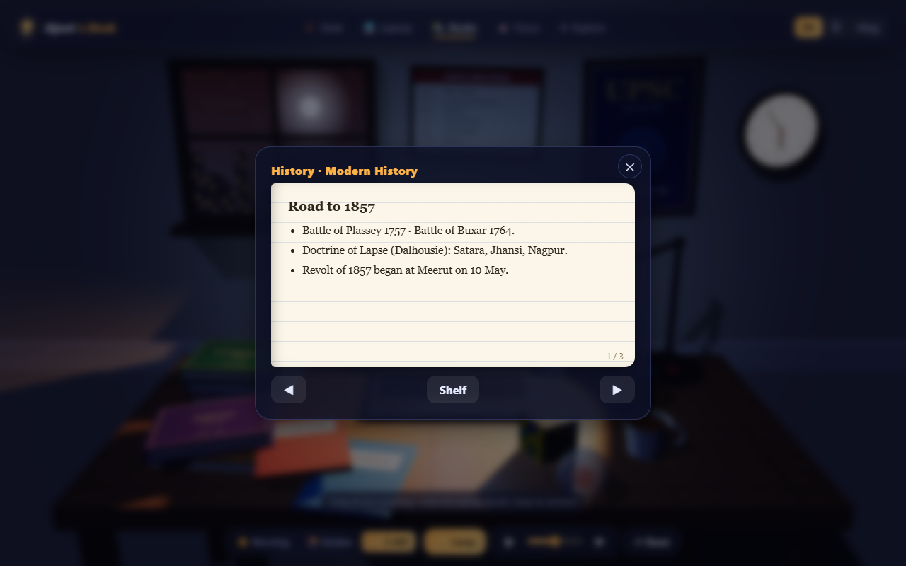 | 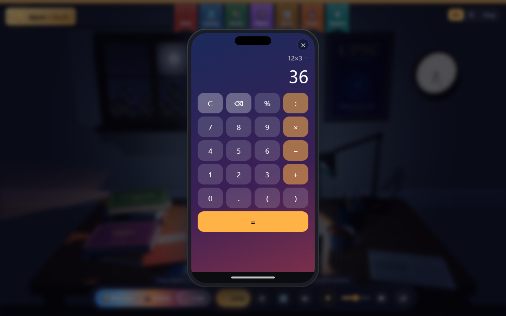 | 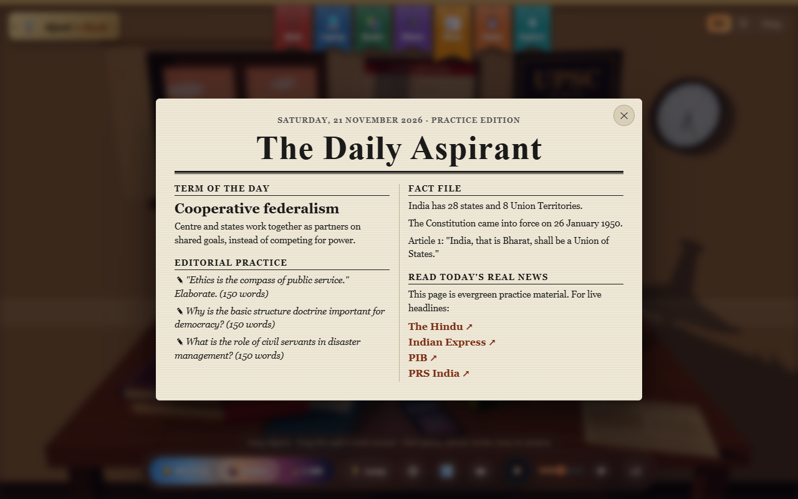 |

| 🎚 Music controller | ⚙️ Settings | 🖍 Whiteboard |
|---|---|---|
| 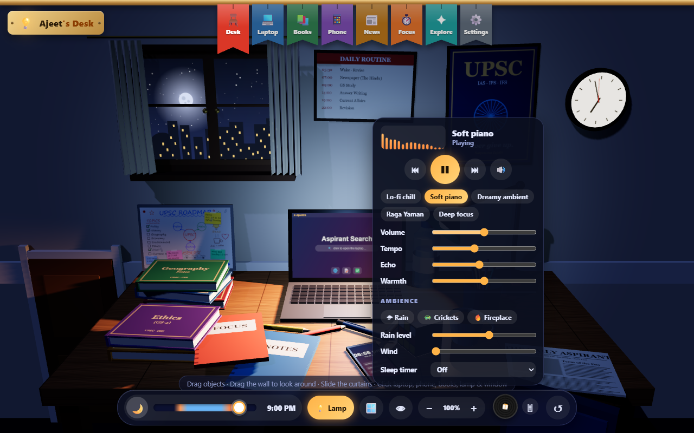 | 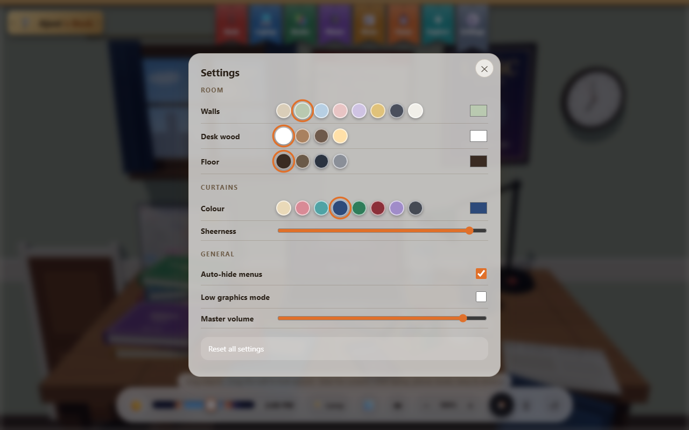 | 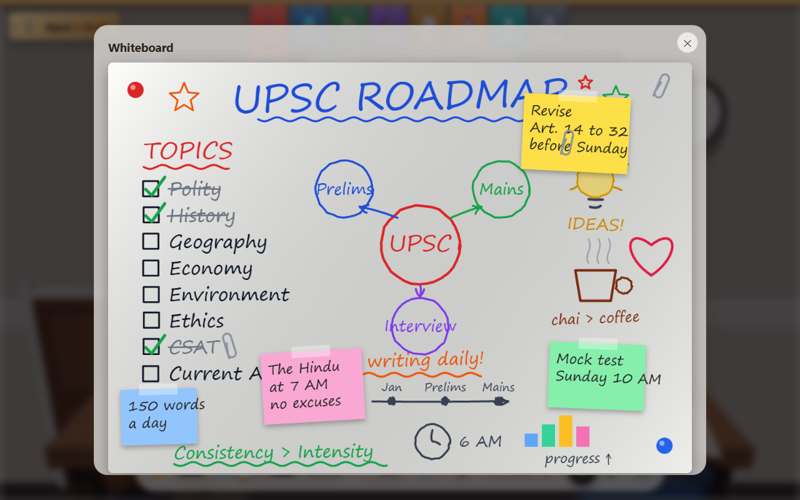 |

| 🌧 Rain on the glass | ⛈ Storm and lightning | 🌫 Dawn fog |
|---|---|---|
| 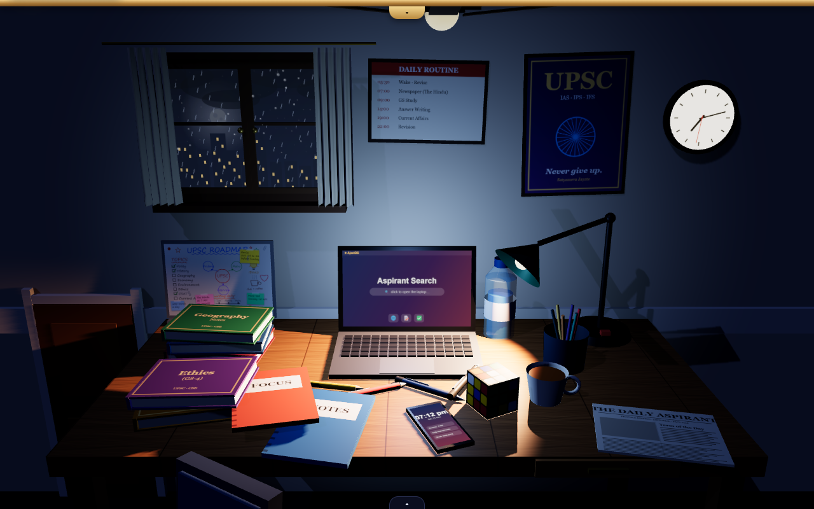 | 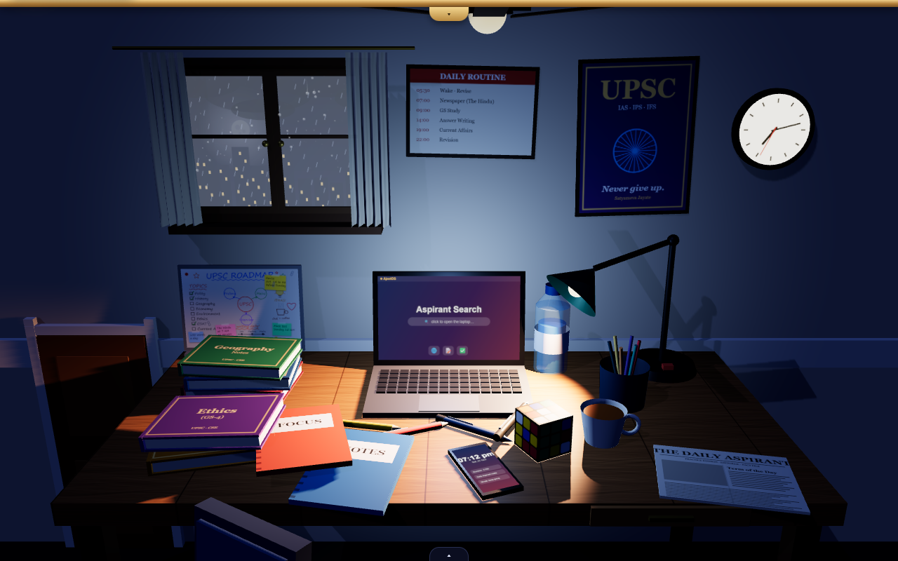 | 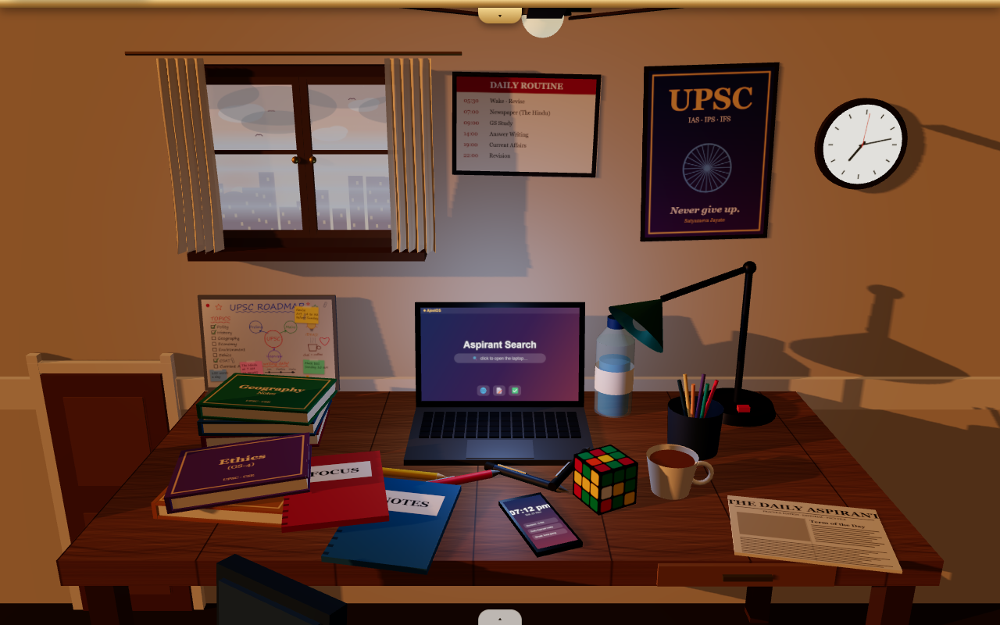 |

| 🌀 Ceiling fan | 🗄 Surprise drawer |
|---|---|
| 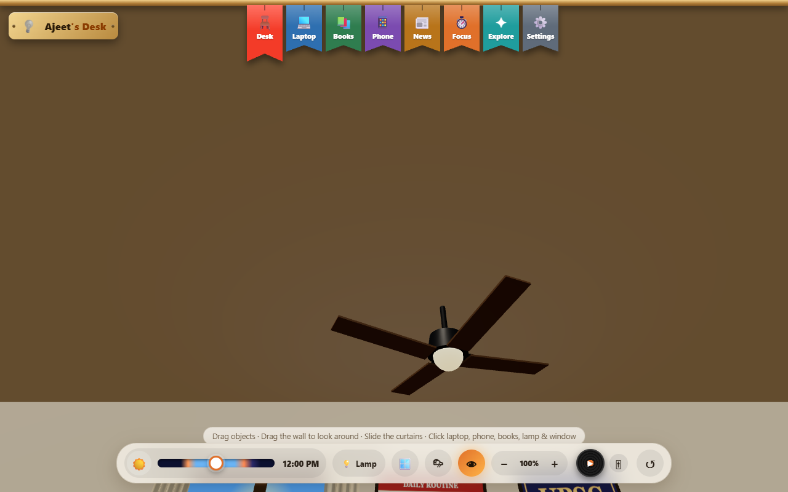 | 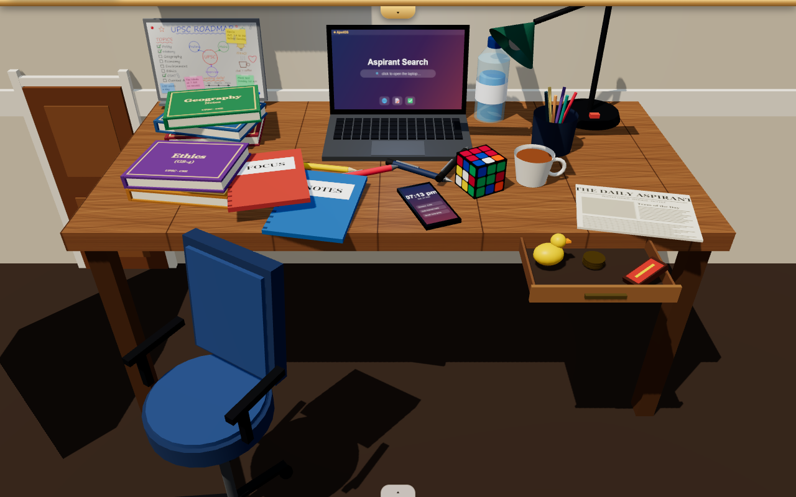 |

| 👁 First-person view | 📱 Mobile |
|---|---|
| 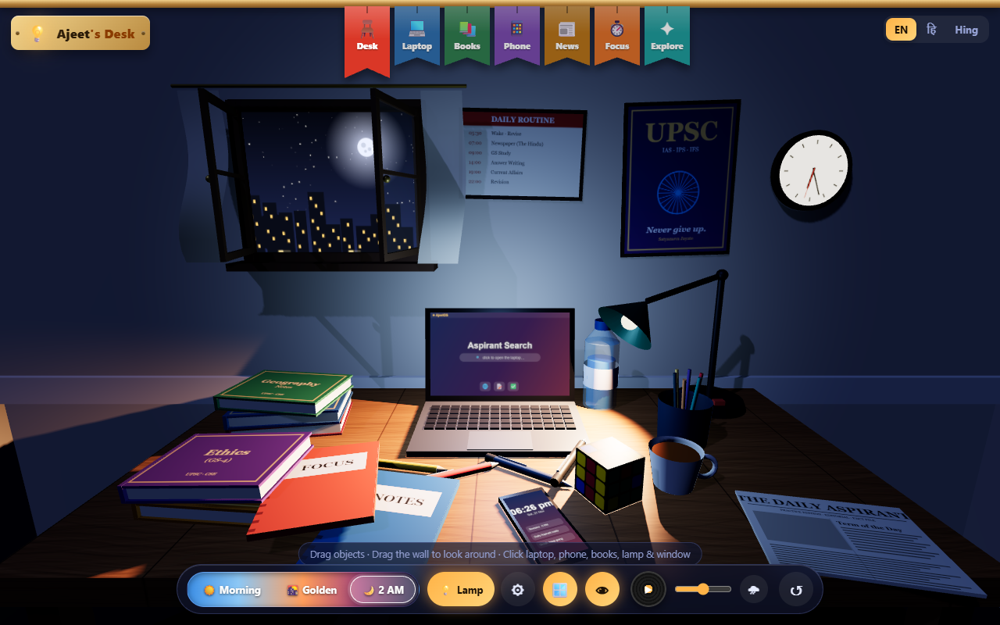 |  |

## ✨ What you can do

**Look around**
- **Drag the wall** to look around. **Zoom** with `+` / `−`, the mouse wheel, or pinch on a phone.
- **First-person mode** (the 👁 button): stand at the desk and look around the whole room, including the roller chair, the bookshelf and the door.

**The desk**
- **Laptop** – zoom into a small web OS: Chrome-style search (Wikipedia API), auto-saved Notes, syllabus tracker.
- **Smartphone** – lock screen, calculator, UPSC quiz, lo-fi player, shortcuts to the rest of the desk.
- **Newspaper** – "The Daily Aspirant": term of the day, answer-writing prompts, fact file, links to real news.
- **Books** (Polity, History, Geography, Economy, Ethics) with revision notes. **Notebook** = Pomodoro timer.
- **Real physics** (Three.js + cannon-es): toss the bottle, cup, Rubik's cube, paperweight, books, phone, paper. **Pens and a pencil** you can flick and spin. Every material makes its own sound.

**Weather, fan and drawer**
- **Weather** (the 🌦 button, or Settings): Auto, Clear, Rain, Storm, Fog. Rain drops cling to the window glass and slide down leaving trails, storms bring lightning flashes with delayed thunder, and **fog rolls in at dawn** by itself. Skies darken and the room light dims under cloud.
- **Ceiling fan**: look up in first-person view. Click it for Off / Low / High. It spins, hums, and makes the curtains sway more.
- **Desk drawer**: click the drawer in the desk front. It slides out with **3 random surprise items** (chocolate, rubber duck, mystery key, coins, a note card, stress ball, USB drive). Click them for a reaction, or drag them out onto the desk.

**Whiteboard, music and settings**
- **Whiteboard** (left of the desk): a hand-drawn UPSC roadmap with topics, doodles, sticky notes and paper clips. Click it to open a big view and **draw on it** with markers (colours, size, eraser, save as PNG). Your drawing is remembered.
- **Music controller**: 5 generated styles (Lo-fi chill, Soft piano, Dreamy ambient, Raga Yaman, Deep focus), previous / next, a live visualizer, volume, tempo, echo and warmth, plus ambience layers (rain, wind, crickets, fireplace) and a sleep timer.
- **Settings**: change the colour of the **walls, desk, floor and curtains** (presets or any colour), curtain sheerness, auto-hide menus, low-graphics mode and master volume. Saved in your browser.

**The room**
- **Day slider** – slide through all 24 hours. Sun and moon travel across the sky, light and shadows follow, city windows light up at night. Click the sun icon to run the day automatically.
- **Lamp** – one control: switch, brightness, warmth and aim, or just drag the lamp on the desk to aim it.
- **Curtains** – drag them sideways to slide, they wave in the breeze.
- **Window** – opens for fresh air (wind sound, swaying curtains). Click the sky for fireworks, click the sun or moon to jump the time. Traffic and birds move outside.
- **Morning birds** – open the window and birds fly in, perch on the sill and sing. Click one and it flies off.
- **Roller chair** – click it to spin and roll. **Door** behind the desk – click to swing it open.
- **Lo-fi music and rain** are generated live with WebAudio, so there are no audio files.

**Interface**
- Ribbon navbar hanging from a brass rail (Desk, Laptop, Books, Phone, News, Focus, Explore, Settings). It reacts to your cursor.
- The top and bottom bars **hide when not needed** and slide back when you move to the edge (or tap the tab).
- Smooth transitions everywhere. Works on mobile.

## 🧱 Tech

Three.js r160 · cannon-es 0.20 · WebAudio · vanilla JS, bundled with esbuild into one classic script (`dist/app.js`) so it runs from `file://`.

```
index.html      page + UI markup
css/style.css   UI, ribbons, dock, themes, responsive
js/main.js      3D scene, physics, lighting, camera, input
js/birds.js     3D birds that perch and sing
js/gadgets.js   phone apps + newspaper
js/os.js        laptop OS (search, notes, syllabus)
js/audio.js     generated music styles, ambience, birdsong, effects
js/musicpanel.js music controller panel
js/board.js     whiteboard art + drawing
js/books.js     book notes
js/i18n.js      UI strings (the site is English-only)
dist/app.js     built bundle (what index.html loads)
```

### Rebuild after editing `js/`

```bash
npm install
npm run build
```

## 💡 Ideas for later

Answer-writing coach (timer + word counter), mock-test mode on the laptop, a wall calendar counting down to Prelims, a tea-making mini game, streaks for daily study hours.

---
Made with ☕ and too many tabs open.
